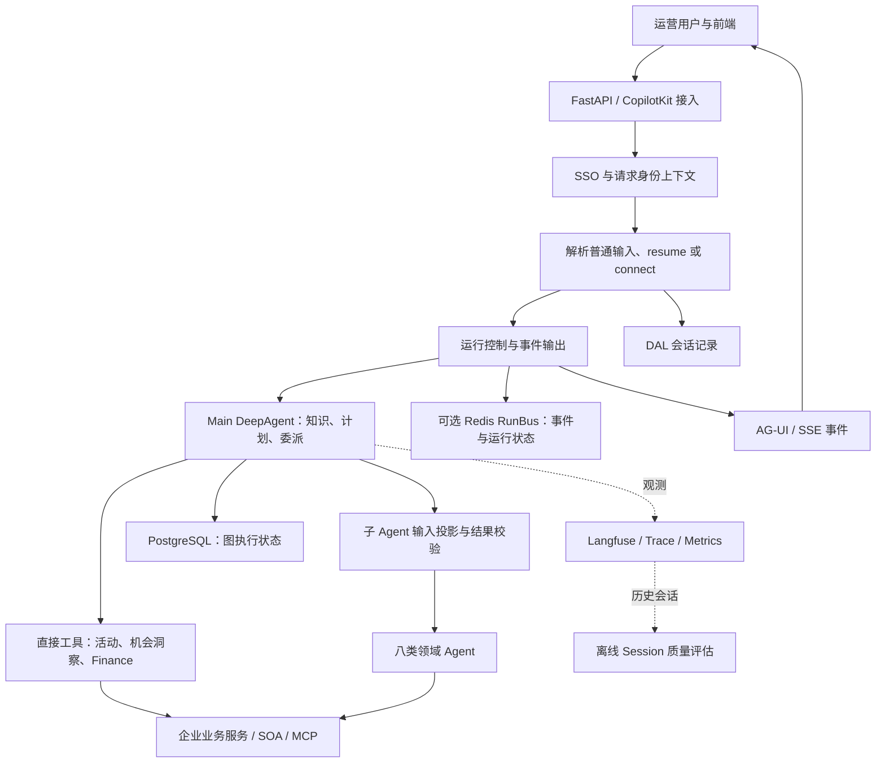

# Campaign AI 项目全景：业务、技术与源码地图

> 阅读基线：2026-10-26，本机 `/Users/Floweryu/Workspace/ibu_campaign_copilot`，分支 `docs/tech-analyze`，commit `3fef0b6dbf46f3906f43322d73ddb277dd7de551`。内容依据注册、调用方、领域实现和状态契约整理；未拉取远端、未验证线上部署、未执行业务请求或测试。源码可以证明机制存在，不能直接证明业务效果与个人贡献。

## 1. 这个项目究竟在做什么

Campaign AI 是面向营销运营的 Agent 服务端：把自然语言需求逐步转成活动信息、招商规则、选品池、优惠券玩法、秒杀配置、图片、多语言页面和投放配置。用户看到的是对话、预览与确认；系统实际要完成的是查真实资源、补齐参数、调用企业接口、保存执行状态并报告真实结果。

需要先建立三个认识：

- **目标是完成业务操作。** 产物是活动 ID、池 ID、图片 URL、页面内容与投放方案，不只是生成一段建议。
- **流程由业务需求驱动。** 用户可以新建整场活动，也可以只查一个池、修改页面或配置广告；八个子 Agent 不代表每次都必须调用八个。
- **框架与业务规则分工。** Main 组织任务，领域实现完成具体操作，代码守住结构、状态与副作用边界。

代码入口是 [build_main_agent](../../../../../Workspace/ibu_campaign_copilot/campaign/agent/main/agent.py#L198) 与 [compile_subagent_graphs](../../../../../Workspace/ibu_campaign_copilot/campaign/agent/subagent_registry.py#L105)。项目是服务端仓库；CopilotKit／AG-UI 是其前端接入协议与适配层，不能据此认为完整前端产品都在这个 Python 仓库中。

## 2. 从业务需求理解完整能力范围

| 运营希望完成什么 | 主要执行者 | 业务产物／结果 | 学习时首先区分什么 |
|---|---|---|---|
| 创建、查询或切换活动 | Main tools | 主／子活动 ID、活动信息与绑定上下文 | 已创建但回查失败，不等于可以再次创建 |
| 选择目标市场与城市 | Main 的机会洞察工具 | 市场、城市建议和分析文档 | 业务机会评估不等于 Agent 质量评分 |
| 发起招商、收集供给 | sourcing | 招商规则 ID、产线与时间信息 | 招商规则不等于最终选品池 |
| 从供给中形成可用商品集合 | selection | 选品池 schema_id | 草稿、预览和真实写入是不同状态 |
| 创建优惠券策略并接入活动玩法 | coupon | draft_id、promotion_id、play_id、奖池／规则 ID | 待审批草稿不等于可用券与完成绑定 |
| 配置限时促销机制 | flash-sale | play、场次、秒杀池及 QA 任务 ID | 创建 QA 任务不等于 QA 已通过 |
| 生成多语言、多尺寸素材 | image | 按 locale／尺寸组织的图片 URL 与质量结果 | 生成成功、质检通过、目标齐全分别判断 |
| 搭建和修改多语言落地页 | page | file_id、各 locale 的 content_id 与预览／发布结果 | 内容文件与语言版本不能混用 |
| 完成活动报备及通知配置 | application-notify | 报备记录及内容／通知配置结果 | 配置通知不等于已确认所有收件人收到邮件 |
| 建立广告投放配置并处理审批 | ads | 广告方案 scheme_id、策略／素材及审批结果 | 方案存在不等于已获批或获得实际曝光 |
| 预算规划、实际 ROI 咨询 | Main 的 Finance 转接工具 | 外部 Finance 返回的会话结果 | 本服务负责转接，不能把外部计算算法说成自己实现 |

八个领域 Agent 的注册集合以 [SUBAGENT_SPECS](../../../../../Workspace/ibu_campaign_copilot/campaign/agent/subagent_registry.py#L1) 为准；活动建壳、机会洞察和 Finance 属于 Main 直接工具，不额外混计为本地注册子 Agent。各业务逐项实现见 [08 业务能力与技术实现](08-业务能力与技术实现.md)。

## 3. 架构图：一条请求穿过哪些层

这是一张职责图，不代表每层都部署成独立服务。Main 与领域 Agent 在当前 Python 进程中组织运行；领域工具再访问外部业务系统。RunBus 是可选能力，缺失时 `stream_handler` 会走直接流式路径。图中的 PostgreSQL、Redis 和会话记录不是同一份数据的三个名称。

依据：[lifespan](../../../../../Workspace/ibu_campaign_copilot/campaign/app.py#L66)、[stream](../../../../../Workspace/ibu_campaign_copilot/campaign/agent/stream_handler.py#L396)、[_boot_runtime](../../../../../Workspace/ibu_campaign_copilot/campaign/agent/graph_runtime.py#L35)、[build_main_agent](../../../../../Workspace/ibu_campaign_copilot/campaign/agent/main/agent.py#L198)。

## 4. 启动阶段与一次请求的执行阶段

**启动时**，FastAPI lifespan 创建运行资源，进入 `deepagent_lifespan` 初始化 PostgreSQL Saver，编译领域图，再构建 Main 根图，并写入运行时注册表。应用尝试配置 RedisRunBus，另启动临时文件清理调度器。模型与连接信息由配置读取；本导读不复制实际配置值。

**收到消息时**，HTTP 入口调用统一 `handle_agui_chat_stream`。解析器给出 thread_id、run_id 和图输入，服务端从 SSO 上下文读取身份，组装图配置与观测信息，并按需要落用户消息。普通消息进入新一轮执行，resume 进入原等待点，connect 则读取已有运行／历史事件，不应被理解成重新执行业务。

**执行中**，Main 的 middleware 派生本轮业务上下文；模型调用直接工具或 `task()`。领域输出通过包装层校验后回写。遇到 interrupt，本轮可以先把待确认内容交给前端，下一请求再继续。

**展示与保存**，AG-UI 事件表达文本、工具与状态变化，SSE 传输它们；启用 RunBus 后后台 worker 与 HTTP 消费者分开。Langfuse 记录执行观察，离线脚本另行评估历史会话。依据：[build_graph_input](../../../../../Workspace/ibu_campaign_copilot/campaign/agent/request_parser.py#L166)、[inject_main_context](../../../../../Workspace/ibu_campaign_copilot/campaign/agent/main/middleware.py#L200)、[start_run](../../../../../Workspace/ibu_campaign_copilot/campaign/agent/run_supervisor.py#L853)、[build_session_bundle](../../../../../Workspace/ibu_campaign_copilot/scripts/langfuse_eval/bundle.py#L1068)。

注意 `app.py` 仍含“无数据库与 Redis”的旧描述；实际 lifespan 已初始化 PostgreSQL 并尝试启用 Redis。理解当前架构应沿执行代码，不能只看标题或注释。

## 5. 技术点—问题—业务价值对照

| 技术点 | 解决什么工程问题 | 支撑哪类业务 | 已核对入口 |
|---|---|---|---|
| FastAPI 与统一流式 handler | 两种前端入口重复实现、输入与恢复语义分叉 | 对话、确认、重连 | [handle_agui_chat_stream](../../../../../Workspace/ibu_campaign_copilot/campaign/agent/stream_handler.py#L661) |
| DeepAgents + LangGraph | 多轮工具调用、领域委派及有状态运行 | Main 与八类领域任务 | [build_main_agent](../../../../../Workspace/ibu_campaign_copilot/campaign/agent/main/agent.py#L198) |
| Pydantic 契约 | 自由文本和字典无法稳定检查结构 | 参数、任务结果、产物 | [TaskSnapshot](../../../../../Workspace/ibu_campaign_copilot/campaign/schemas/state/contracts/task_snapshot.py#L28) |
| ActivityPlan 类型化操作 | 局部更新误删计划、半批次变更 | 页面与模块进度编排 | [apply_activity_plan_operations](../../../../../Workspace/ibu_campaign_copilot/campaign/agent/main/activity_plan_ops.py#L416) |
| 输入投影与产物回写约束 | 子任务历史干扰和跨领域状态污染 | 所有注册子 Agent | [wrap_state_driven_subagent_runnable](../../../../../Workspace/ibu_campaign_copilot/campaign/agent/state_driven_subagent.py#L205) |
| 语义 Spec + builder + guard | 模型拼错复杂报文或业务枚举 | 多产品线选品 | [_to_draft](../../../../../Workspace/ibu_campaign_copilot/campaign/agent/subagents/selection/tools/draft.py#L283) |
| interrupt + Command(resume) | 用户回复跨请求、需停在等待点 | 选品、报备、页面发布等 | [build_graph_input](../../../../../Workspace/ibu_campaign_copilot/campaign/agent/request_parser.py#L166) |
| PostgreSQL Saver 与连接池 | 图状态跨请求持久化及连接故障处理 | 确认恢复 | [_postgres_checkpointer](../../../../../Workspace/ibu_campaign_copilot/campaign/agent/graph_runtime.py#L66) |
| asyncio worker + Queue | HTTP 断线影响业务执行 | 长任务执行与停止 | [start_run](../../../../../Workspace/ibu_campaign_copilot/campaign/agent/run_supervisor.py#L853) |
| Redis Streams 与快照 | 实时事件丢失后无法重放 | 执行中重连 | [RedisRunBus](../../../../../Workspace/ibu_campaign_copilot/campaign/agent/run_bus.py#L1) |
| SSO + ContextVar | 并发请求身份混淆、业务 state 携带原始身份信息 | SOA／MCP 调用 | [bound_sso_context](../../../../../Workspace/ibu_campaign_copilot/campaign/utils/sso_context.py#L108) |
| SOA 调用封装 | 环境、身份与响应解释散落在业务中 | 活动、券、池等真实写入 | [soa_call_with_context](../../../../../Workspace/ibu_campaign_copilot/campaign/soa/client.py#L262) |
| MCP adapter 与工具筛选 | 不同外部工具接入形式不一致 | 领域工具与页面服务 | [get_mcp_tools_for_skills](../../../../../Workspace/ibu_campaign_copilot/campaign/agent/mcp_tools.py#L114) |
| Skills、知识快照、middleware | 规则规模大、动态状态过时 | 活动类型与领域指导 | [inject_main_context](../../../../../Workspace/ibu_campaign_copilot/campaign/agent/main/middleware.py#L200) |
| Prompt Cache 分块 | 稳定内容与动态字段混杂 | 重复模型调用的输入组织 | [_system_message_with_context](../../../../../Workspace/ibu_campaign_copilot/campaign/agent/main/middleware.py#L143) |
| 模型适配与串行工具配置 | 不同模型请求参数与工具并发语义差异 | Main 和领域推理 | [get_agent_model](../../../../../Workspace/ibu_campaign_copilot/campaign/agent/config.py#L310) |
| JSON Patch、稳定模块标记、locale 写锁 | 页面局部修改越界或覆盖其他语言 | Foxpage 页面搭建 | [_write_locales_with_repair](../../../../../Workspace/ibu_campaign_copilot/campaign/agent/subagents/page/foxpage/foxpage_gateway.py#L1079) |
| 生成—QC—定向重试 | 素材尺寸／语言目标缺失与质量失败 | 多语言图片 | [build_image_execution_graph](../../../../../Workspace/ibu_campaign_copilot/campaign/agent/subagents/image/graph.py#L1338) |
| Langfuse 与按子树归因 | 只看总调用量无法定位消耗 | 质量诊断与成本分析 | [_sum_descendant_usage](../../../../../Workspace/ibu_campaign_copilot/campaign/observability/langfuse_subagent_stats.py#L206) |
| 确定性指标 + LLM Judge | 模型自述无法证明业务成功 | Agent 会话离线评估 | [_task_verdict](../../../../../Workspace/ibu_campaign_copilot/scripts/langfuse_eval/task_success.py#L299) |
| 数据评分与可解释报告 | 目的地选择缺少数据支撑 | 市场／城市机会洞察 | [RegionScorer](../../../../../Workspace/ibu_campaign_copilot/campaign/evaluator/region_scorer.py#L932) |
| 定时清理运行文件 | 生图与会话临时产物持续累积 | 服务运行维护 | [create_scheduler](../../../../../Workspace/ibu_campaign_copilot/campaign/scheduler.py#L85) |

“支撑业务”是机制与业务的对应关系，不代表已测得效率提升或成功率。模型缓存收益、运行可靠性和业务效果仍需数据验证。

## 6. 读懂状态模型，才能把各模块连起来

| 名称 | 含义与所有者 | 不要混淆为 |
|---|---|---|
| thread_id | 根会话／checkpoint 定位标识 | 每次执行的 run_id 或访问授权 |
| run_id | 一轮执行与事件传输标识 | 主活动 ID |
| main_campaign_id / sub_campaign_id | 外部活动资源身份 | 模型自由生成的占位符 |
| bound_main_campaign_id | 当前会话绑定的活动范围 | 永久不可切换的活动限制 |
| campaign_info | 查询或创建后持有的活动结构 | ActivityPlan 的执行进度 |
| activity_plan | Main 维护的计划与模块状态 | 外部系统已经完成的证明 |
| task_status / TaskSnapshot | 领域任务最新语义结果 | 不可变事件历史 |
| artifacts | 真实资源引用的集合 | 尚未写入的临时草稿 |
| effective_knowledge | Main 保存的活动知识快照 | 每轮自动更新的外部最新知识 |
| 领域 scratch / drafts | 领域执行中的私有工作数据 | 所有其他 Agent 可直接使用的完成产物 |

定义依据：[CampaignState](../../../../../Workspace/ibu_campaign_copilot/campaign/schemas/state/state_models.py#L247)、[MainAgentState](../../../../../Workspace/ibu_campaign_copilot/campaign/agent/main/state.py#L10)、[Artifacts](../../../../../Workspace/ibu_campaign_copilot/campaign/schemas/state/artifacts.py#L156)、[TaskSnapshot](../../../../../Workspace/ibu_campaign_copilot/campaign/schemas/state/contracts/task_snapshot.py#L28)。切换活动时 [_switch_context_model](../../../../../Workspace/ibu_campaign_copilot/campaign/agent/main/tools/campaign_shell.py#L84) 清理旧活动残留并重新绑定，理解这一点才能解释为什么相同会话里不能直接混用两个活动的产物。

## 7. 五类存储与记录分别保存什么

| 存储或记录 | 主要用途 | 典型读取者 | 边界 |
|---|---|---|---|
| PostgreSQL checkpoint | 图状态与恢复信息 | LangGraph runtime | 不是外部业务资源的事务记录 |
| Redis RunBus | 有保留期限的运行事件、快照、控制信号 | worker 与重连客户端 | 不是无限历史，也不自动接管失联 worker |
| 会话／消息 DAL | 用户消息、回复与历史分页 | 会话服务、历史回放 | 聊天存在不等于任务结果成功 |
| 外部业务平台 | 活动、池、券、页面、广告等真实资源 | 领域查询与写入工具 | 本地 state 可能落后于其他操作者的修改 |
| Langfuse | 执行观察、模型使用量与评估记录 | 诊断与离线评估脚本 | 是观测证据，不是业务完成的唯一权威源 |

会话记录实现见 [ConversationMemoryService](../../../../../Workspace/ibu_campaign_copilot/campaign/services/conversation_memory_service.py#L37)；流式入口使用记录 ID 对齐历史消息，避免同一用户消息在重连时出现两份。不要因为项目有 memory 字段，就把所有持久化统称为“长期智能记忆”。

## 8. 目录怎样读，哪些地方容易误入

| 目录 | 阅读目标 |
|---|---|
| `campaign/app.py`、`api/`、`agent/stream_handler.py` | 服务怎样启动、请求如何进入 |
| `agent/main/` | 活动知识、计划、直接工具与委派 |
| `agent/subagents/` | 每个业务真正做什么、怎样确认与返回 |
| `schemas/state/` | 字段语义、产物 ID、状态约束 |
| `soa/`、`agent/mcp_tools.py` | 怎样访问真实外部系统 |
| `knowledge_base/`、领域 `skills/` | 哪些业务规则由运行时资料提供 |
| `repository/`、`services/` | 会话数据与基础存储访问 |
| `observability/`、`scripts/langfuse_eval/` | 怎样观察、归因与评价 Agent |
| `campaign/evaluator/` | 业务机会评分，和上一行不是一件事 |
| `tests/`、`e2e/` | 哪些分支有确定性验证，哪些依赖真实系统 |

`runners/` 存在历史与未迁移实现，但不是当前新功能的一般落点；以根图注册和实际调用方确定活跃路径。旧 README、注释和设计文档可帮助理解动机，不能替代当前执行代码。

继续阅读：[08 按业务逐项追踪](08-业务能力与技术实现.md) → [09 从一条请求到掌握项目](09-源码演练与学习路线.md) → 01–06 的技术拆解与问题。
