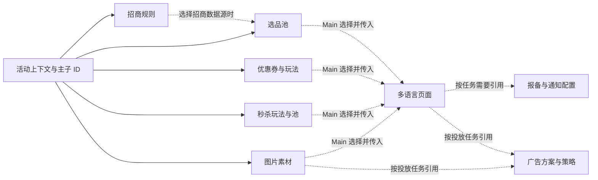

# 按业务掌握项目：输入、技术、执行链与产物

> 阅读基线：2026-10-26，本机 `/Users/Floweryu/Workspace/ibu_campaign_copilot`，分支 `docs/tech-analyze`，commit `3fef0b6dbf46f3906f43322d73ddb277dd7de551`。内容依据注册、调用方、领域实现和状态契约整理；未拉取远端、未验证线上部署、未执行业务请求或测试。源码可以证明机制存在，不能直接证明业务效果与个人贡献。

本篇按运营任务展开。下面的需求句是帮助读代码的教学例子，不是已执行的业务请求。判断完成时看真实产物与领域状态，不能只看模型回复。总体架构见 [00 项目全景](00-项目全景与技术地图.md)。

## 1. 创建、查询与切换活动：所有活动内操作的上下文基础

**业务问题：** 活动名称、类型、地区、语言、时间和主题需要补齐并关联到正确资源；用户还会查询或切换已有活动。

**实现链：** `confirm_campaign_type` 确定类型并取得知识 → Main 补齐信息 → `create_campaign_shell` 校验草稿、展示可编辑确认 → 创建后查询真实活动 → 回写活动信息与主／子 ID。已有活动走 `query_campaign`，切换时清理旧计划和产物，避免把旧活动的池或页面带到新活动。

**技术解决的问题：** Pydantic 和工具校验约束输入；interrupt 支持用户在表单中修改参数；创建后回查校准真实资源；状态重置处理会话内活动切换。

**完成依据：** `campaign_info`、main/sub_campaign_id 和绑定范围。创建已成功但回查失败时，代码明确提示通过 query_campaign 恢复，不能盲目再次创建。

源码：[confirm_campaign_type](../../../../../Workspace/ibu_campaign_copilot/campaign/agent/main/tools/confirm_campaign_type.py#L27) → [create_campaign_shell](../../../../../Workspace/ibu_campaign_copilot/campaign/agent/main/tools/campaign_shell.py#L638) / [query_campaign](../../../../../Workspace/ibu_campaign_copilot/campaign/agent/main/tools/campaign_shell.py#L817) → [_switch_context_model](../../../../../Workspace/ibu_campaign_copilot/campaign/agent/main/tools/campaign_shell.py#L84)。

## 2. 招商 sourcing：形成后续可用的供给规则

**业务问题：** 运营要按产线、活动与时间条件组织供给。招商产物是规则，不是展示页面，也不等同选品池。

**教学需求：** “为当前活动配置相应产品线的招商规则。”需要活动身份和真实规则参数，缺少信息时应澄清。

**实现链：** `prepare_node` 形成领域草稿 → 完整时进入 `execute_node`，否则直接汇报缺参 → 执行前校验时间与活动条件 → 仅携写工具调用创建 → `finalize_node` 输出 TaskSnapshot 并合并规则产物。部分成功也保留已成功规则，不能把整个批次笼统说成全失败或全成功。

**技术特点：** 这是带明确 prepare/execute/finalize 阶段的图；执行阶段仍可使用受限 Agent 调用写工具。当前代码没有在 sourcing 内再做一套确认 interrupt，而依赖 Main 委派前组织确认；缺参返回 Main 再对话。

**产物与下游：** `artifacts.sourcing.sourcing_rules` 保存 rule_id、product_line、时间与链接，选品使用招商数据源时可引用这些真实规则。

源码：[build_subagent_sourcing](../../../../../Workspace/ibu_campaign_copilot/campaign/agent/subagents/sourcing/graph.py#L1031)、[execute_node](../../../../../Workspace/ibu_campaign_copilot/campaign/agent/subagents/sourcing/graph.py#L682)、[finalize_node](../../../../../Workspace/ibu_campaign_copilot/campaign/agent/subagents/sourcing/graph.py#L851)、[SourcingRuleArtifact](../../../../../Workspace/ibu_campaign_copilot/campaign/schemas/state/artifacts.py#L15)。

## 3. 选品 selection：把需求变成商品池

**业务问题：** 不同产品线的查询工具、筛选指标、数据源和接口报文不一致；用户还需要预览、修改和重试。

**教学需求：** “在当前活动下建一个符合指定城市和条件的酒店池。”城市 ID 等事实需要查询，不能由例子随意填充。

**实现链：** 领域 Agent 查实体／规则 → `draft_selection_pools` 接收语义定义 → 产品线 Spec 与 builder 构造报文并做 guard → `preview_selection_pools` 暂停等待回复 → `upsert_selection_pools` 读取草稿、检查预览与活动条件并写入 → finalize 转成快照及正式产物。

**技术解决的问题：** 把模型语义决策与确定性报文结构分开；将可修复错误回传模型；统一写入边界；通过成功产物处理部分重复创建。查询工具覆盖七条产线，但工具存在、构造器存在和真实端到端通过是不同证据。

**产物与限制：** `artifacts.selection_pools` 记录 schema_id、产线及成功／失败信息。预览按池名记录，非完整 payload 授权；去重依赖已写入 artifacts 的成功记录，同一内层循环尚未 finalize 的结果不能据此保证去重。

源码：[build_subagent_selection](../../../../../Workspace/ibu_campaign_copilot/campaign/agent/subagents/selection/graph.py#L333) → [_to_draft](../../../../../Workspace/ibu_campaign_copilot/campaign/agent/subagents/selection/tools/draft.py#L283) → [preview_selection_pools](../../../../../Workspace/ibu_campaign_copilot/campaign/agent/subagents/selection/tools/preview.py#L139) → [upsert_selection_pools](../../../../../Workspace/ibu_campaign_copilot/campaign/agent/subagents/selection/tools/upsert.py#L130)。深入阅读 [02 可靠工具执行](02-语义契约与可靠工具执行.md)。

## 4. 优惠券 coupon：从策略草稿到可绑定的券玩法

**业务问题：** “创建一张券”实际可能涉及参数推断、外部审批、已审批券导入、玩法分组、奖池和规则绑定，不能用一个成功标记覆盖所有阶段。

**实现链：** 推断或复制参数 → 缺参时集中询问 → 创建／修改 TCP 草稿 → 查询审批或导入已有 promotion → 准备玩法分组并取得相应确认 → 创建 play 和各 locale 奖池 → 配置券包、规则与奖品绑定 → finalize 汇总。

**关键代码细节：** `confirm_create_coupon_drafts_tool` 虽然名字带 confirm，但当前说明和实现已移除单独的“创建草稿确认”环节；参数齐全时可直接创建草稿。玩法分组则通过 prepare/confirm/cancel 分支处理，模型解释用户批准。外部业务审批状态与对话中的用户确认也不是同一件事。

**技术解决的问题：** 结构化参数与字段知识处理复杂券配置；两节点 agent/finalize 图保留工具循环灵活性；产物保存阶段和多个 ID，使跨轮继续审批与绑定成为可能。复制券需要读取完整配置，摘要降级标记用于避免把不完整模板当完整事实。

**产物：** CouponArtifact 包含 draft_id、promotion_id、play_id、prize_pool_ids、rule_set_id、阶段、参数快照，以及部分操作是否已完成的标记。不能把 draft_id 当作已审批 promotion_id，也不能把多语言奖池压成同一个 ID。

源码：[build_subagent_coupon](../../../../../Workspace/ibu_campaign_copilot/campaign/agent/subagents/coupon/graph.py#L652)、[infer_coupon_drafts_tool](../../../../../Workspace/ibu_campaign_copilot/campaign/agent/subagents/coupon/tools.py#L250)、[confirm_create_coupon_drafts_tool](../../../../../Workspace/ibu_campaign_copilot/campaign/agent/subagents/coupon/tools.py#L578)、[confirm_play_groups_tool](../../../../../Workspace/ibu_campaign_copilot/campaign/agent/subagents/coupon/tools.py#L1401)、[advance_coupon_binding_tool](../../../../../Workspace/ibu_campaign_copilot/campaign/agent/subagents/coupon/tools.py#L1580)、[CouponArtifact](../../../../../Workspace/ibu_campaign_copilot/campaign/schemas/state/artifacts.py#L43)。

## 5. 秒杀 flash-sale：有阶段依赖的业务机制搭建

**业务问题：** 秒杀不是简单设置一个折扣，需要玩法壳、场次、库存、补贴、商品池、营销配置及 QA 任务。前一步产物通常是下一步输入，恢复时还要避免重复创建。

**实现链：** construct_input／params_infer → R1 建玩法壳及确认 → R2 库存、补贴准备与写入及确认 → R3 建池、营销配置确认、创建 QA 任务 → finalize。反馈可以回到前面重新推断，并非永远单向直线。

**技术特点：** 多阶段 StateGraph 明确承载依赖；写入节点与确认节点分离，尽量使已完成写入状态在等待前被记录。确定性预检和结构化状态帮助模型理解可以继续的阶段，但仍不能据此承诺全链路 Exactly-once。

**产物：** FlashSaleArtifact 保存 play_id、round_ids、flash_sale_pool_id、产线、地区与 qa_task_id。QA 任务 ID 仅证明任务已创建，不能直接说 QA 通过或活动已经可投放。

源码：[build_subagent_flash_sale](../../../../../Workspace/ibu_campaign_copilot/campaign/agent/subagents/flash_sale_mechanism.py#L4664)、[r3_qa_task_node](../../../../../Workspace/ibu_campaign_copilot/campaign/agent/subagents/flash_sale_mechanism.py#L4204)、[finalize_flash_sale_snapshot](../../../../../Workspace/ibu_campaign_copilot/campaign/agent/subagents/flash_sale_mechanism.py#L4769)、[FlashSaleArtifact](../../../../../Workspace/ibu_campaign_copilot/campaign/schemas/state/artifacts.py#L98)。

## 6. 图片 image：从多模态需求到通过质量检查的素材

**业务问题：** 输入可能包括图片和文档，输出需要满足多 locale、多尺寸、文案与素材要求；某个目标生成失败，不应靠一张成功图片冒充全批完成。

**实现分两层：** 外层 Image Agent 使用读取、请求准备、素材准备、澄清、执行与结束工具；内层执行图是 image_agent → qc_agent → finalize，并按质量反馈决定是否定向重试。

**关键分支：** 本轮没有任何图片产出时直接 finalize，不让空 QC 触发无意义全量重跑；有产出才做 QC。当前重试路由只考虑 PETA_MODEL 失败单元格，FIGMA_COMPOSE 失败不采用同样重生策略，并受轮次预算限制。

**技术解决的问题：** 将需求澄清与技术执行分开；用质量结果驱动有限重试；按 locale 和尺寸保留产物，防止不同目标互相覆盖。上传与最终快照还要表达部分失败和目标完整性。

**产物：** `artifacts.banners[locale]` 的 pc/mobile 是兼容槽位，by_size 才保留完整尺寸映射；图片快照和 QC 信息用于解释哪些目标成功。外层 build_image_main_agent 没有另外保留独立长期 checkpoint，不能按其他子图照搬说明。

源码：[build_image_main_agent](../../../../../Workspace/ibu_campaign_copilot/campaign/agent/subagents/image/graph.py#L1379)、[build_image_execution_graph](../../../../../Workspace/ibu_campaign_copilot/campaign/agent/subagents/image/graph.py#L1338)、[route_after_image](../../../../../Workspace/ibu_campaign_copilot/campaign/agent/subagents/image/graph.py#L1267)、[route_after_qc](../../../../../Workspace/ibu_campaign_copilot/campaign/agent/subagents/image/graph.py#L1306)、[build_image_task_snapshot](../../../../../Workspace/ibu_campaign_copilot/campaign/agent/subagents/image/graph.py#L1040)、[BannerAsset](../../../../../Workspace/ibu_campaign_copilot/campaign/schemas/state/artifacts.py#L117)。

## 7. 页面 page：把业务资源放进正确的多语言组件

**业务问题：** 活动页面不只是 HTML 文案，还需要绑定池、券、素材等真实资源，准确定位模块，并维护各语言版本、预览、QA 和发布。

**实现链：** Main 明确委派一个 Page action 与所需资源 → Page 工具调用 `run_foxpage_request` → 按 action 创建骨架、更新模块、页面 meta 或条款 → gateway 读最新 DSL → 模型生成语义 patch → 代码检查写入范围并保存各 locale → 返回结果，再由 Main 决定后续动作。

**关键技术：** module 是组件知识 key，module_id 是页面内稳定实例 ID；file_id 标识文件，content_id 对应单个 locale。写入使用进程内按 content 的锁；不同 locale 可分别执行，单 locale 的 patch 失败允许一次 repair，并先重新读取最新 DSL。模块缺失和根路径越界等问题不能靠换一个模型输出绕过。

**QA 与发布：** 工具集合分别提供 qa_page、complete_qa 和 publish_page。发布工具显式调用 interrupt 获取确认，再调用发布 runner；“QA → 确认 → 发布”是调用约定，不能仅凭工具说明就认定存在完整的、不可绕过的最新 QA 结果与发布 payload 强绑定。此类更严格保证需要继续核验和测试。

**产物：** page_files 中保存 file_id 和各 locale 的 content_id／页面 URL，单次 PageTaskOutput 还保留各 locale 状态、预览与 live URL。部分语言失败必须如实表达。Page 负责执行给定任务，不负责全局选择下一模块。

源码：[build_subagent_page](../../../../../Workspace/ibu_campaign_copilot/campaign/agent/subagents/page/graph.py#L21)、[make_apply_confirmed_module](../../../../../Workspace/ibu_campaign_copilot/campaign/agent/subagents/page/tools/module.py#L27)、[run_foxpage_request](../../../../../Workspace/ibu_campaign_copilot/campaign/agent/subagents/page/foxpage/service.py#L25)、[_write_locales_with_repair](../../../../../Workspace/ibu_campaign_copilot/campaign/agent/subagents/page/foxpage/foxpage_gateway.py#L1079)、[make_publish_page](../../../../../Workspace/ibu_campaign_copilot/campaign/agent/subagents/page/tools/publish_page.py#L86)、[sync_page_state](../../../../../Workspace/ibu_campaign_copilot/campaign/agent/subagents/page/state_sync.py#L20)。

## 8. 活动报备与通知 application-notify：分步生成、确认与写入

**业务问题：** 报备记录、内容编辑与通知邮件配置属于不同操作，用户可能从已有报备记录继续中间步骤，不能每次都重新开始。

**实现链：** intent_recognition 选择 Step 1/2/3 的 prepare → 准备只读工具与结构化草稿 → confirm 用 interrupt 接收批准、反馈或取消 → execute_step_write 用确定性代码写 SOA → 下一步或终态。三个步骤分别是建立报备、编辑报备内容、配置通知。

**技术解决的问题：** 将草稿推理、用户确认、真实写入分成不同阶段；prepare 不开放写工具；execute 不再次让模型修改已经形成的写入参数。反馈返回 prepare，失败进入明确结果分支。

**产物与边界：** 记录 current_application_id、各步骤结果，并汇总到 application_notify 产物。这个能力在代码中是活动报备与通知配置，不宜泛化成面向终端用户的报名系统；配置成功也不等于验证了邮件实际送达。

源码：[intent_recognition](../../../../../Workspace/ibu_campaign_copilot/campaign/agent/subagents/application_notify/graph.py#L124)、[_confirm_step](../../../../../Workspace/ibu_campaign_copilot/campaign/agent/subagents/application_notify/graph.py#L328)、[_execute_step](../../../../../Workspace/ibu_campaign_copilot/campaign/agent/subagents/application_notify/graph.py#L395)、[finalize_application_notify_snapshot](../../../../../Workspace/ibu_campaign_copilot/campaign/agent/subagents/application_notify/graph.py#L521)。

## 9. 广告投放 ads：查询、配置与审批操作

**业务问题：** 广告位、frame、素材、策略、方案和审批各有实体，写入要绑定目标活动，并允许查询场景独立执行。

**实现链：** 外层 agent/finalize 图 → 动态注入活动、图片、页面和附件上下文 → 查询或写工具 → 相应交互／确认 → 汇总任务快照与方案产物。工具列表覆盖方案、策略、素材、广告位查询以及提交、查询、撤回审批等操作。

**技术特点：** 只向模型提供领域工具，通用内置工具被过滤；终态 marker 触发结束，finalize 根据本轮结果和 artifacts 形成统一 TaskSnapshot。上下文每次模型调用重建，避免继续使用恢复前的旧图片或页面 URL。

**产物与边界：** AdsArtifact 记录 scheme_id；其他执行细节在领域 scratch 和快照中表达。创建方案、提交审批、审批通过和实际广告曝光不是同一状态。远端投放成效不在本次代码分析中验证。

源码：[build_subagent_ads](../../../../../Workspace/ibu_campaign_copilot/campaign/agent/subagents/ads/agent.py#L494)、[inject_ads_context](../../../../../Workspace/ibu_campaign_copilot/campaign/agent/subagents/ads/agent.py#L170)、[_finalize_ads_snapshot](../../../../../Workspace/ibu_campaign_copilot/campaign/agent/subagents/ads/agent.py#L376)、[ADS_TOOLS](../../../../../Workspace/ibu_campaign_copilot/campaign/agent/subagents/ads/tools/__init__.py#L1)、[AdsArtifact](../../../../../Workspace/ibu_campaign_copilot/campaign/schemas/state/artifacts.py#L113)。

## 10. 机会洞察与资源包：为活动设计提供数据依据

**业务问题：** 在目标目的地和活动时间确定后，运营需要选择客源市场、城市及资源方向，不能仅靠模型自由生成推荐。

**实现链：** `opportunity_insights` 确认历史扫描范围、目的地、KPI 等参数 → 调用 `campaign.evaluator.run_real.run_evaluation` → 数据整理与 RegionScorer 评估 → 生成报告并上传 → 返回 target_markets、target_cities、analysis_file_url。工具不自动把建议写成最终活动决策，Main 仍需结合用户意图使用。

**技术特点：** 分析由确定性数据整理和评分支撑；RegionScorer 提供酒店、航班等分项及区域／城市结果，含季节、画像与 KPI 等维度。源码里有百分位、自然断点和区间统计等方法，但各策略的权重与适用性需要按具体评分路径进一步阅读，不能只凭函数存在声称所有算法在每次评估都会使用。

`get_destination_resource_package` 返回目的地活动的权威资源包 Markdown。它和机会评分一起辅助方案形成；这里的 evaluator 评的是业务机会，**不是** `scripts/langfuse_eval` 中评 Agent 是否成功的 Judge。

源码：[opportunity_insights](../../../../../Workspace/ibu_campaign_copilot/campaign/agent/main/tools/destination_tools.py#L234)、[run_evaluation](../../../../../Workspace/ibu_campaign_copilot/campaign/evaluator/run_real.py#L786)、[RegionScorer](../../../../../Workspace/ibu_campaign_copilot/campaign/evaluator/region_scorer.py#L932)、[get_destination_resource_package](../../../../../Workspace/ibu_campaign_copilot/campaign/agent/main/tools/destination_tools.py#L338)。

## 11. Finance 转接：跨系统能力协作

**业务问题：** 用户希望做预算规划或分析实际 ROI，而计算、权限和确认流程由 Finance 系统负责。

**实现链：** Main 调用 `finance_chat(message)` → 验证请求身份、thread 与 tool_call_id → 派生 session_id/request_id → 调用外部 Finance 聊天接口 → 原样传回可行动结果。连接失败、服务端错误和结果未知分开处理，不自动用新身份重试。

**技术价值与边界：** 请求关联与未知结果表达使跨系统对话更可追踪；它是直接 HTTP 集成，不是因为对端也叫 Agent 就自动成为 A2A 实现。本仓库不应重新计算外部 ROI，也不能仅凭收到回复就认定预算操作完成。

源码：[finance_chat](../../../../../Workspace/ibu_campaign_copilot/campaign/agent/main/tools/finance.py#L35)。本次只读实现，没有访问 Finance 服务。

## 12. 附件、会话与观测：主业务为什么能被持续使用

文档／图片附件给模型提供业务输入，`document_reader` 支持读取并转换为 Markdown；领域资料又通过受限 reference 工具读取。这两条路径用途不同，不能把通用附件读取和 Skill 目录权限混在一起解释。见 [document_reader.py](../../../../../Workspace/ibu_campaign_copilot/campaign/agent/tools/document_reader.py#L1)、[make_read_reference](../../../../../Workspace/ibu_campaign_copilot/campaign/agent/tools/read_reference.py#L20)。

会话服务保存用户消息和回复，重连与历史分页复用记录；checkpoint 保存执行状态。观测回调把运行关联到 Langfuse，Token 归因与离线评估帮助定位反复调用和失败场景。它们服务于使用连续性与质量迭代，不代替外部业务系统的真实数据。见 [ConversationMemoryService](../../../../../Workspace/ibu_campaign_copilot/campaign/services/conversation_memory_service.py#L37)、[lf_callbacks](../../../../../Workspace/ibu_campaign_copilot/campaign/observability/langfuse_callbacks.py#L28)、[_task_verdict](../../../../../Workspace/ibu_campaign_copilot/scripts/langfuse_eval/task_success.py#L299)。

## 13. 把业务连起来：资源依赖，而不是固定必经顺序

虚线表示可选资源依赖：不是所有活动都需要券、秒杀、报备或广告，也不是产物一出现就会触发下游自动执行。Main 决定用哪个资源及其用途，领域只执行明确任务。

## 14. 判断自己是否真正理解一个模块

对每个模块都能回答：用户输入什么、代码先检查什么、哪一步真的写外部系统、失败保存什么、成功返回哪个 ID、谁消费这个 ID、什么条件下需要人、重试会不会重复。能够沿上面的链接逐项指认，才比只记住框架名称更接近掌握项目。
