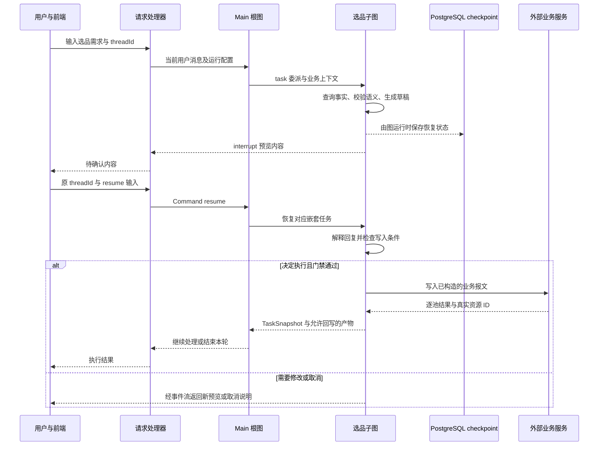

# 从一条请求到掌握项目：源码演练与学习路线

> 阅读基线：2026-10-26，本机 `/Users/Floweryu/Workspace/ibu_campaign_copilot`，分支 `docs/tech-analyze`，commit `3fef0b6dbf46f3906f43322d73ddb277dd7de551`。内容依据注册、调用方、领域实现和状态契约整理；未拉取远端、未验证线上部署、未执行业务请求或测试。源码可以证明机制存在，不能直接证明业务效果与个人贡献。


本篇提供可实际执行的阅读步骤。这里的“演练”默认指沿代码跟踪数据与分支；本次没有启动服务、连接生产系统或创建业务资源。先读 [00 项目全景](00-项目全景与技术地图.md) 和 [08 业务能力](08-业务能力与技术实现.md)，再使用本篇检查理解程度。

## 1. 用一条完整需求串起核心技术

教学需求：“创建一场酒店营销活动，按指定条件生成选品池，制作两个语言版本的图片和落地页；预览后再决定发布。”具体活动信息、地区、locale 和实体 ID 需要由用户提供或平台查询，本例不虚构执行结果。

这条案例选择活动、选品、图片、页面四个能力作为主线。若用户希望先招商，Main 再插入 sourcing；若活动需要券或秒杀，再委派对应领域。它不是系统固定要求每次走完的流水线。

| 步骤 | 用户看到什么 | 代码在哪里执行 | 应追踪什么数据／分支 |
|---|---|---|---|
| 1. 建立会话并提交需求 | 对话界面开始接收输入 | [chat_start](../../../../../Workspace/ibu_campaign_copilot/campaign/api/chat_stream_routes.py#L46)、[campaign_agent_chat_stream](../../../../../Workspace/ibu_campaign_copilot/campaign/api/chat_stream_routes.py#L104) | conversationId／threadId 与 runId 的区别 |
| 2. 解析输入 | 开始事件或输入错误 | [build_graph_input](../../../../../Workspace/ibu_campaign_copilot/campaign/agent/request_parser.py#L166)、[stream](../../../../../Workspace/ibu_campaign_copilot/campaign/agent/stream_handler.py#L396) | 普通 dict、Command(resume)、connect 三条路径 |
| 3. 组织上下文与活动类型 | 澄清必要信息、形成方案 | [inject_main_context](../../../../../Workspace/ibu_campaign_copilot/campaign/agent/main/middleware.py#L200)、[confirm_campaign_type](../../../../../Workspace/ibu_campaign_copilot/campaign/agent/main/tools/confirm_campaign_type.py#L27) | 知识快照、动态活动 state、初始计划 |
| 4. 创建活动 | 可编辑的建壳确认及真实创建结果 | [create_campaign_shell](../../../../../Workspace/ibu_campaign_copilot/campaign/agent/main/tools/campaign_shell.py#L638) | 用户编辑后的有效参数、主子 ID、创建后回查 |
| 5. 委派选品 | 领域查询和候选池方案 | [_build_subagents](../../../../../Workspace/ibu_campaign_copilot/campaign/agent/main/agent.py#L59)、[prepare_input](../../../../../Workspace/ibu_campaign_copilot/campaign/agent/state_driven_subagent.py#L218) | 本次任务消息与允许回写字段 |
| 6. 构造池草稿 | 参数错误反馈或可预览草稿 | [_to_draft](../../../../../Workspace/ibu_campaign_copilot/campaign/agent/subagents/selection/tools/draft.py#L283)、[build_request](../../../../../Workspace/ibu_campaign_copilot/campaign/agent/subagents/selection/pool/builder.py#L38) | 语义 Spec、payload、static_config、错误列表 |
| 7. 预览与恢复 | 用户确认、修改或取消 | [preview_selection_pools](../../../../../Workspace/ibu_campaign_copilot/campaign/agent/subagents/selection/tools/preview.py#L139)、[_extract_resume_command](../../../../../Workspace/ibu_campaign_copilot/campaign/agent/request_parser.py#L73) | interrupt ID、原 threadId、回复值、预览记录 |
| 8. 写入池并收回结果 | 逐池成功或失败 | [upsert_selection_pools](../../../../../Workspace/ibu_campaign_copilot/campaign/agent/subagents/selection/tools/upsert.py#L130)、[finalize_selection_node](../../../../../Workspace/ibu_campaign_copilot/campaign/agent/subagents/selection/graph.py#L294) | selection_output → TaskSnapshot → artifacts.selection_pools |
| 9. 生成图片 | 各目标图片与质量结果 | [build_image_main_agent](../../../../../Workspace/ibu_campaign_copilot/campaign/agent/subagents/image/graph.py#L1379)、[build_image_execution_graph](../../../../../Workspace/ibu_campaign_copilot/campaign/agent/subagents/image/graph.py#L1338) | locale／尺寸矩阵、QC 与定向重试分支 |
| 10. 创建骨架、写模块与 meta | 各语言页面预览 | [build_subagent_page](../../../../../Workspace/ibu_campaign_copilot/campaign/agent/subagents/page/graph.py#L21)、[run_foxpage_request](../../../../../Workspace/ibu_campaign_copilot/campaign/agent/subagents/page/foxpage/service.py#L25) | module_id、file_id、每个 locale 的 content_id，最新 DSL |
| 11. QA 与发布交互 | QA 结果、发布确认和真实结果 | [build_page_tools](../../../../../Workspace/ibu_campaign_copilot/campaign/agent/subagents/page/tools/__init__.py#L56)、[make_publish_page](../../../../../Workspace/ibu_campaign_copilot/campaign/agent/subagents/page/tools/publish_page.py#L86) | QA 与 publish 的动作区别、确认值、逐 locale 发布结果 |
| 12. 回放与后续分析 | 刷新后继续看到状态与历史 | [attach_or_replay](../../../../../Workspace/ibu_campaign_copilot/campaign/agent/run_supervisor.py#L967)、[build_session_bundle](../../../../../Workspace/ibu_campaign_copilot/scripts/langfuse_eval/bundle.py#L1068) | UI 恢复、图恢复与离线评分各自读取什么 |

重要细节：`confirm_campaign_type` 是写入已识别的活动类型与知识，不代表这里一定弹出用户确认卡；真正的建壳表单在后续工具中。阅读时按实际调用，而不是仅按函数名理解产品交互。

## 2. 选品暂停恢复的时序图



这是按职责简化的时序，省略了多次模型调用、SSE adapter 和 RunBus；checkpoint 的具体保存由运行时管理，并非业务工具手写每条箭头。恢复重入和去重限制见 [03 确认与恢复](03-人工确认与持久化恢复.md)、[02 工具执行](02-语义契约与可靠工具执行.md)。

## 3. 每个阶段应拿得出的“完成证据”

| 阶段 | 至少要看到什么 | 不能拿来替代它的东西 |
|---|---|---|
| 活动创建 | 真实主／子 ID 与回查后的活动结构 | 一段生成好的活动文案 |
| 选品完成 | 逐池结果与有效 schema_id | 草稿预览、工具开始事件 |
| 图片完成 | 所需 locale／尺寸的实际产物及相应质量结果 | 随便一张成功图片 |
| 页面模块写入 | 正确 content_id 对应 locale 的真实保存结果 | 模型生成的 patch 候选 |
| 页面发布 | 目标 locale 的发布结果与相应地址 | 预览地址、一次 QA 回复 |
| 报备／广告完成 | 对应业务操作返回及阶段状态 | 仅存在任务快照或对话确认 |

这些证据可以用来定位“不知道卡在哪”的问题：先识别最后一个已得到真实证据的边界，再沿下一步调用查看输入、错误和状态。不要跳过业务层，只研究模型 prompt。

## 4. 三个变化场景，检验是否读懂了真实系统

### 场景 A：用户预览后改变筛选条件

先找 resume 如何进入原 interrupt，再看修改后的语义定义如何替换草稿、是否重新预览、写入工具到底检查什么。当前按池名保存的预览记录没有强绑定内容摘要，因此不能用“池名没变”证明新条件已经批准。应能够指出 [preview_selection_pools](../../../../../Workspace/ibu_campaign_copilot/campaign/agent/subagents/selection/tools/preview.py#L139) 与 [_unpreviewed](../../../../../Workspace/ibu_campaign_copilot/campaign/agent/subagents/selection/tools/upsert.py#L62) 中的具体字段。

### 场景 B：页面一个语言版本成功、另一个失败

先确定两个 locale 对应不同 content_id，再追 `normalize_locale_results`、状态归并及 PageTaskOutput。需要说明哪个语言已写、哪个失败、是否适合局部重试，不能重新全量创建所有页面。入口在 [make_apply_confirmed_module](../../../../../Workspace/ibu_campaign_copilot/campaign/agent/subagents/page/tools/module.py#L27) 与 [_write_locales_with_repair](../../../../../Workspace/ibu_campaign_copilot/campaign/agent/subagents/page/foxpage/foxpage_gateway.py#L1079)。

### 场景 C：客户端刷新或用户点击停止

刷新看 connect／attach_or_replay，不应自动创建第二轮业务。停止看 stop_event 与 worker 的帧边界检查，已经发出的远端写入不会因此回滚。Redis 事件还在不代表原进程 Task 还在，也不代表新 Pod 已接管。入口在 [_stop_run_handler](../../../../../Workspace/ibu_campaign_copilot/campaign/api/copilotkit_routes.py#L176)、[start_run](../../../../../Workspace/ibu_campaign_copilot/campaign/agent/run_supervisor.py#L853) 与 [attach_or_replay](../../../../../Workspace/ibu_campaign_copilot/campaign/agent/run_supervisor.py#L967)。

## 5. 七个学习阶段及验收成果

| 阶段 | 阅读入口 | 要解决的疑问 | 学完后应能交代的成果 |
|---|---|---|---|
| 1. 业务全貌 | 00 + 08、Artifacts | 项目提供哪些业务能力？ | 用自己的话画出资源依赖，区分八个领域和 Main 工具 |
| 2. 请求与生命周期 | app、routes、stream_handler、graph_runtime | 从哪里进、何时初始化、怎样退出？ | 串出启动链及普通／resume／connect 三条请求路径 |
| 3. 状态与编排 | Main、注册表、包装层、TaskSnapshot、计划操作 | 哪些事实由谁维护？ | 指出计划、任务结果、产物、私有草稿的所有权 |
| 4. 深挖选品一条线 | selection graph、draft、builder、preview、upsert、finalize | 模型究竟填了什么，代码做了什么？ | 跟踪一个池从语义输入到 schema_id，并说清两处失败窗口 |
| 5. 对比其他领域 | 08 对应入口 | 为什么不同业务使用不同图结构？ | 对比 sourcing、coupon、flash-sale、image、page 的执行差异 |
| 6. 可靠性与外部边界 | RunBus、Saver、SSO、SOA、MCP、DAL | 连接、进程、身份和远端状态如何交互？ | 解释断线、重试、取消、权限与结果未知各自处理位置 |
| 7. 质量与性能 | Langfuse、Token 归因、langfuse_eval | 怎样证明系统变好，而非只是能运行？ | 区分业务机会评分与 Agent 评分，写出一份固定任务集的验证方案 |

现有六篇专题不是孤立背诵题库：第 01 篇对应阶段 3，第 02 篇对应阶段 4，第 03／04 篇对应阶段 6，第 05 篇贯穿模型输入与成本，第 06 篇对应阶段 7。第 07 篇放到最后，用来表达已经真正理解、且实际参与过的工作。

## 6. 静态演练与可选测试入口

**不运行服务也可以完成的练习：** 给每个关键函数标记“读什么 state、写什么 state、是否访问外部系统、是否可能中断”；对同一业务将模型决定与代码判断分列；手工跟踪失败分支返回的 TaskSnapshot；用测试断言检验自己理解的预期行为。

有项目依赖环境后，可从范围清楚的现有测试开始。以下仅为学习命令，本次未执行：

```bash
cd /Users/Floweryu/Workspace/ibu_campaign_copilot
uv run pytest -q tests/agent/main/test_activity_plan_ops.py tests/agent/test_subagent_checkpoint_namespace.py
uv run pytest -q tests/deepagent/selection/test_poolspec_builder.py tests/deepagent/selection/test_upsert_tool.py
uv run pytest -q tests/agent/test_run_supervisor.py tests/agent/main/test_middleware.py
```

命令来自项目现有 pytest 配置与已存在的测试文件。先理解测试 fixture 和 mock，避免把它们的断言范围扩大成线上验收。真实模型、SOA、页面发布和业务 E2E 应在明确的测试环境与数据范围内单独验证，本导读没有执行这些操作。

## 7. 掌握整个项目的自测清单

1. 能否用业务语言区分招商规则、选品池、券策略、玩法、奖池和广告方案？
2. 为什么有八个子 Agent，却不是每条需求都走八步？
3. Main 的语义编排与领域内部固定 StateGraph 是否冲突？
4. 从 HTTP 入口到 `create_deep_agent`，哪一步读身份、哪一步读业务 state？
5. `activity_plan`、`task_status` 和 `artifacts` 分别代表什么，谁有权更新？
6. 模型生成的参数、builder 生成的 payload、远端创建的资源有什么区别？
7. 用户回复跨请求后，thread_id、interrupt ID 和 run_id 各起什么作用？
8. sourcing 没有内部确认、coupon 不同阶段有不同确认、page 发布有 interrupt，这些差异为什么存在？
9. 同一子 Agent 新任务为什么不应沿用上次私有草稿，而恢复旧任务又需要保留状态？
10. 页面 module 与 module_id、file_id 与 content_id、locale 与 region 分别如何区分？
11. 图片生成成功、QC 通过、全部目标齐全是否是一回事？
12. 连接断开、进程退出、任务取消和远端回滚有什么区别？
13. PostgreSQL、Redis、DAL、外部平台和 Langfuse 分别保存什么？
14. `campaign/evaluator` 和 `scripts/langfuse_eval` 分别评什么，谁调用它们？
15. 工具名有 confirm 是否一定弹确认框？代码注释是否一定反映当前实现？
16. 给出某个“成功率更高／成本更低”的结论，需要补哪些执行样本与统计口径？

能沿源码回答以上问题后，再使用阅读导航的 12 道重点问题检验取舍能力。如果只能说出术语，不能指出数据在哪个函数被检查、写入和消费，就回到对应业务主线继续读。
