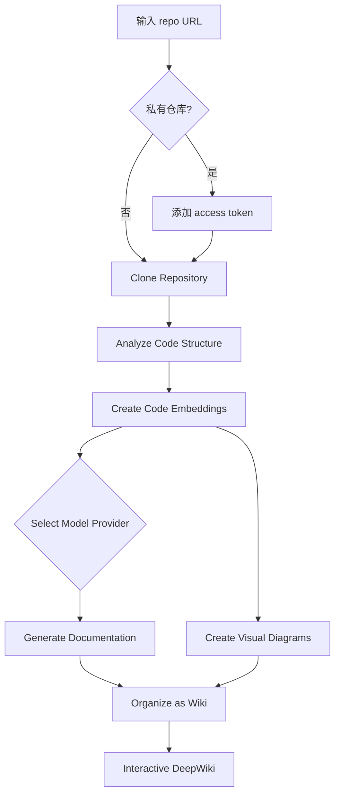

# Code Graph RAG 知识整理

> 来源：飞书知识库《Code Graph RAG 调研 & 设计》及其全部子文档
> 主文档：https://trip.larkenterprise.com/wiki/Syqjw1RwfihNgTkR7vlcEFFznrc
> 整理日期：2026-08-26

## 文档地图

| 层级 | 文档 | 核心内容 |
| :--- | :--- | :--- |
| 主文档 | Code Graph RAG 调研 & 设计 | 5 层高层架构 + 11 层详细技术架构 + 服务化 + 评测体系 |
| 子文档 | deepwiki-open & code-graph-rag 项目解读 | 两个开源参考实现的流程、提示词、Vector+Graph 结合方式 |
| 子文档 | Code Splitting | 代码分块的必要性、四大挑战、策略选型 |
| 子文档 | Gitlab Knowledge Graph | GKG 的双图架构、Rust ETL、存储引擎、收益 |
| 子文档 | CGR 和 GKG 图数据库存储分析 | 下含 4 篇孙文档 |
| └ 孙文档 | CGR 和 GKG Schema 对比 | 建模风格、维护成本、Nebula 性能、AI 友好度 |
| └ 孙文档 | 准确度对比（Java 项目） | 29 个用例，共性痛点 + 独有缺陷 |
| └ 孙文档 | 准确度对比（Python 项目） | 24 个用例，动态特性瓶颈 |
| └ 孙文档 | 基于 Nebula Graph 构建高可用 Git 多版本代码知识图谱方案 | Merkle DAG + 抽象符号层 + 双向 BFS |

---

## 一、核心命题

代码库 RAG 与通用文本 RAG 的本质差异：

- 代码有**严格语法结构**（可用 AST/CST 精确切分，而非靠语义猜测边界）
- 代码有**复杂显式依赖**（imports、继承、调用链，天然适合图建模）
- 代码问答对**精确性要求极高**（错一个符号名，答案就完全不可用）

因此设计目标是"代码感知的 RAG"：向量检索负责语义意图，图检索负责结构推理，两者互补。

---

## 二、架构：5 层高层模型

用于划清职责边界、统一团队认知。

| 层 | 职责 |
| :--- | :--- |
| Source Layer（源数据层） | 对接 GitHub/GitLab，管理权限与分支，数据入口 |
| Processing Layer（处理层） | 核心计算：代码 → AST/CST → 智能分块 → 元数据提取 → 代码-文本联合向量 |
| Storage Layer（存储层） | Vector DB 存语义向量，Graph DB 存依赖关系（调用链、继承） |
| Context Layer（上下文层） | 系统"大脑"：理解 Query、混合检索、组装完整上下文 |
| Application Layer（应用层） | 最终出口：Context + Prompt 工程 → 调用 LLM 生成/问答 |

---

## 三、架构：11 层详细技术设计

### Layer 1 · Code Repository Layer

- 多平台适配：GitHub、GitLab
- 实时同步：Webhook 监听 `git push` 事件，实现准实时更新
- 分支策略：明确索引哪些分支（如 `main`）

### Layer 2 · Code Ingestion Pipeline

**文件过滤**（严格白/黑名单）
- 排除：`node_modules`、`venv`、`__pycache__`
- 包含：主流语言源文件、README、OpenAPI 规范

**增量更新：Merkle Tree**（参考 Cursor 实践）
- 每个文件计算 Hash，父目录 Hash 由子文件 Hash 组合而成
- 只需重新索引 Hash 变化的子树，大幅降低 Re-indexing 成本

### Layer 3 · AST/CST Parsing

选型：**Tree-sitter（CST）**

理由：
- 增量解析，速度极快
- 支持 40+ 语言
- 容错性强，代码有语法错误也能解析
- 生成的 CST 保留注释和格式——这对 RAG 至关重要（注释是最好的自然语言描述）

### Layer 4 · Intelligent Chunking

选型：**LlamaIndex `CodeSplitter`**
理由：开箱即用；依赖等结构信息由 Graph 侧补充，不必在分块阶段解决。

详见后文「五、代码分块（Code Splitting）」。

### Layer 5 · Metadata Extraction

| 字段 | 用途 |
| :--- | :--- |
| `language` | 编程语言 |
| `file_path` | 完整路径，用于路径加权 |
| `identifiers` | 函数名、类名、变量名，用于符号搜索 |
| `dependencies` | import 列表 |
| `git_info` | 最后修改人、修改时间，判断代码新鲜度 |
| `complexity` | 圈复杂度，优先检索简单易懂的代码 |

### Layer 6 · Code-Text Joint Embedding

模型选型：**UniXcoder** 或 **StarCoder Embeddings**

**关键增强策略：自然语言描述增强（Natural Language Augmentation）**
- 痛点：代码的 Embedding 与用户自然语言 Query 的 Embedding 在向量空间中往往不匹配
- 解法：Embedding 之前先用轻量级 LLM 为代码块生成 Summary，例如"此函数实现了 OAuth2 的 Token 刷新逻辑"，再对增强后的文本做嵌入

### Layer 7 · Dual Storage Architecture

**Vector Database：Elasticsearch v8+**
- 理由：Hybrid Search 能力最成熟，原生支持 Vector(kNN) + Lexical(BM25) 组合查询，易运维

**Knowledge Graph：Nebula Graph**
- Nodes：File、Class、Function、Module
- Edges：`CALLS`、`INHERITS`、`IMPORTS`、`DEFINES`
- 价值：解决复杂依赖查询，例如"修改这个函数会影响哪些其他模块？"

### Layer 8 · Advanced Retrieval

检索流程：**Hybrid Retrieval + RRF + Rerank**

1. **并行三路检索**
   - Semantic Search（Vector）：捕捉语义，"如何鉴权" → 匹配 `verifyToken`
   - Lexical Search（BM25）：捕捉精确关键字，"ErrorCode_503" → 精确匹配常量定义
   - Graph Traversal：获取上下文，查询函数的调用者与被调用者

2. **融合：Reciprocal Rank Fusion（RRF）**
   ```
   Score = 1/(k + Rank_Vector) + 1/(k + Rank_BM25) + 1/(k + Rank_Graph)
   ```
   优势：无需归一化不同检索器的分数，鲁棒性强

3. **重排序**：Cross-Encoder（如 `bge-reranker-v2-m3`）对 Top-50 精细排序

### Layer 9 · Context Assembly

- **Token Budgeting**：严格控制输入 Token 数，预留足够生成空间
- **依赖注入**：不只放检索到的代码块，还借 Graph DB 自动拉取其 `Imports` 指向的接口定义
- **Prompt 结构**：
  ```plaintext
  [Context]
  File: auth/service.py
  Code: ...

  [Related Interfaces]
  File: interfaces/user.py
  Code: ...

  [User Query]
  ...
  ```

### Layer 10 · LLM Generation

- 模型：Claude 4.5 Sonnet 等
- 必须支持 Streaming，降低用户感知延迟

### Layer 11 · Post-Processing

1. **Syntax Check**：尝试解析生成的代码，确保无基本语法错误
2. **Linter**：运行轻量级 Linter（Ruff / ESLint）
3. **Security Scan**：正则匹配 API Key、Password 等敏感信息
4. **Citation**：自动为生成代码添加引用来源（文件路径 + 行号）

---

## 四、服务化：RAG Service 与 RAG Agent

### RAG Service（被动）

把核心检索逻辑抽为独立服务，封装 **Layer 8 + Layer 9**。

分层视角：

| 层 | 范围 | 形态 |
| :--- | :--- | :--- |
| 索引层 | Layers 1-7 | 离线处理，定期更新 |
| RAG 服务层 | Layers 8-9 | 在线服务，实时检索与上下文组装 |
| 应用层 | Layers 10-11 | 消费 RAG 输出，专注业务逻辑与生成 |

标准化 API：
```plaintext
POST /api/v1/retrieve
{
  "query": "如何实现 OAuth2 token 刷新?",
  "repo_id": "your-repo-id",
  "top_k": 10
}
// -->
{
  "context": "组装好的上下文文本...",
  "sources": [{"file": "...", "lines": [10, 25]}],
  "metadata": {...}
}
```

核心优势：
- **解耦**：应用层自由替换/升级 LLM，无需改动 RAG Service
- **复用**：代码问答、代码补全等多应用共享同一服务
- **扩展**：可容器化水平扩展，应对高并发

### RAG Agent（主动 / Agentic RAG）

```
RAG Agent = 决策层(ReAct / Function Calling) + RAG Service + LLM Generation + Post-Processing
```

与 RAG Service 的区别：Service 是无状态 API，被动接收查询返回上下文（Layer 8-9）；Agent 是有状态智能体，封装 Layer 8-11 并增加决策层。

关键特性：
- **自主决策**：根据意图自动选择检索策略（语义搜索 vs 图遍历）、调整参数
- **多轮对话**：维护历史，理解上下文追问
- **工具调用**：主动执行代码、查询 API 文档
- **反思修正**：自我评估结果，发现问题自动迭代

---

## 五、代码分块（Code Splitting）

### 为什么分块是最关键也最被低估的环节

Sweep AI 的真实案例：一个 400 行的 API endpoint 文件，包含导入语句、常量声明、辅助函数和各 Webhook 端点的业务逻辑。用户搜索 "GitHub Action run" 时，理想匹配是处理 `check_runs completed` 事件的那约 20 行。

- **整文件嵌入**：匹配度仅 5%（20/400）
- **语义分块**：切成 20 个语义块，匹配度接近 100%

简单按行切分会导致：函数签名与实现分离、docstring 与代码脱节、类定义与方法割裂、上下文丢失。

### 四大核心挑战

**1. 语义完整性（Semantic Integrity）**
- 代码有严格结构依赖，完整语义单元应包含 Decorator + Signature + Docstring + Body
- 类方法必须携带类定义的上下文

**2. 上下文保留（Context Preservation）**
- 代码块之间存在隐式依赖（imports、类定义）
- 解法：在 Chunk 的 Metadata 中附加关键 Imports 和父类定义

**3. 尺寸约束（Size Constraints）**
- 主流 Embedding 模型 Token 上限：512-8191
- 代码的 Token-to-Character 比率约 1:5
- **最佳实践：目标 1500 characters（约 40 行 / 约 300 tokens），上限 2000 characters**

**4. 语言多样性（Language Diversity）**
- Python 缩进、JavaScript 花括号、HTML 标签，语法结构差异巨大
- 通用分块器需支持 100+ 语言

> ⚠️ 原文档中的《主流 Chunking 策略对比》为飞书电子表格，MCP 工具无法读取，此处未收录，需查看原文档。

---

## 六、参考实现解读

### 6.1 deepwiki-open

自动为任意 GitHub/GitLab/BitBucket 仓库生成可交互 Wiki。

**生成流程（5 步）**

1. **Repository Ingestion**：克隆仓库，按配置过滤和解析文件
2. **Embedding Generation**：切块 → 向量化 → 存入本地向量库（Faiss）
3. **Structure Determination**：LLM 分析目录结构和 README，生成推荐的 Wiki 目录（XML 格式）
4. **Page Generation**：前端按目录逐页发起生成请求；后端 RAG 从向量库检索与页面主题最相关的片段作为上下文，LLM 生成 Markdown
5. **Caching**：缓存生成结果以便快速访问

**数据流**



**提示词工程的可复用经验**

Structure Determination 阶段：
- 输入 = 完整 file_tree + README 全文
- 要求输出严格的 XML `<wiki_structure>`，每页带 `title` / `description` / `importance` / `relevant_files` / `related_pages`
- 显式要求包含"适合配图的页面"：架构总览、数据流、组件关系、流程工作流、状态机、类层次
- 综合视图生成 8-12 页，精简视图 4-6 页
- 反复强调：只返回 XML，不要 markdown 代码围栏，不要任何解释文字

Page Generation 阶段的硬性约束（对提升可信度很有参考价值）：
- 页面第一个元素必须是 `<details>` 块，列出**至少 5 个** `[RELEVANT_SOURCE_FILES]`
- **每一条重要信息、图表、表格项、代码片段都必须引用来源**，格式固定为 `Sources: [filename.ext:start_line-end_line]()`
- 全页至少引用 5 个不同源文件
- 所有信息必须**仅**来自提供的源文件，不得推断、编造或引入外部知识
- 大量使用 Mermaid 图；强制垂直方向（`graph TD`，禁用 `graph LR`），节点文字不超过 3-4 词
- 反面清单也写进 prompt：不要以 markdown 标题开头、不要 ```` ```markdown ```` 围栏、不要复述问题、不要 "Okay, here's a breakdown" 之类的开场白

**Ask 功能（RAG）**：基于实际代码的上下文感知回答，流式输出，保持对话历史。

**Deep Research 功能**：多轮研究过程，最多 5 次迭代自动继续，分三阶段——
1. Research Plan：概述方法与初步发现（回复以 `## Research Plan` 开头）
2. Research Update：在前一轮基础上叠加新见解
3. Final Conclusion：综合所有迭代给出完整答案

其 prompt 中特别强调：绝不能只回复 "Continue the research"，每轮必须给出实质性发现，且必须保持与前几轮的连续性、聚焦原始问题。

**RAG Template 结构**（AdalFlow 风格）：
```
<START_OF_SYS_PROMPT> ... <END_OF_SYS_PROMPT>
<START_OF_CONVERSATION_HISTORY> ... <END_OF_CONVERSATION_HISTORY>
<START_OF_CONTEXT>
  {index}. File Path: {file_path}  Content: {text}
<END_OF_CONTEXT>
<START_OF_USER_PROMPT> ... <END_OF_USER_PROMPT>
```

**技术栈灵活性**：LLM 支持 Gemini / OpenAI / OpenRouter / Ollama / Azure；Embedding 支持 Google AI / OpenAI（默认）/ Ollama。

### 6.2 code-graph-rag（CGR）

**Tree-sitter 解析方式**

Tree-sitter Query 是一种"类正则"的 AST 模式匹配。以 Java 的 class query 为例，一条 query 覆盖五种声明类型：

```scheme
(class_declaration            name: (identifier) @name) @class
(interface_declaration        name: (identifier) @name) @class
(enum_declaration             name: (identifier) @name) @class
(annotation_type_declaration  name: (identifier) @name) @class
(record_declaration           name: (identifier) @name) @class
```

参考资源：
- 各语言节点 schema：`tree-sitter-<lang>/src/node-types.json`
- Playground：https://tree-sitter.github.io/tree-sitter/7-playground.html

**为什么同时存在 Function 和 Method 两种节点类型**

这是尊重语言语义特性的设计，而非不一致：
- Java 等强 OO 语言：`method_declaration`、`constructor_declaration` 明确识别为 METHOD 节点，用 `DEFINES_METHOD` 关系表达"方法属于类"
- JavaScript：由于原型链机制，即使类内部的 `method_definition` 也视为 FUNCTION 节点——JS 的"方法"本质是挂到原型对象上的函数

**Vector 与 Graph 如何结合**

关键设计：**`node_id` 是连接两个数据库的桥梁**。Qdrant 中每个向量的 id 就是 Memgraph 中对应节点的 node_id。语义搜索命中向量后，立即通过 node_id 回查图库，获取该代码实体的调用链、继承关系等结构信息，实现「语义理解 + 结构推理」的双重能力。

Semantic search 工具链路：
1. `semantic_search_functions()`：自然语言 query → `embed_code()` 生成向量 → `search_embeddings()` 余弦相似度搜索 → 提取 node_ids → `build_nodes_by_ids_query()` 回查图库拿结构信息（qualified_name、file_path 等）→ 与相似度分数合并为 `SemanticSearchResult`
2. `get_function_source_by_id()`：由 node_id 从图库查出文件路径和行号，再读源文件提取代码（语义搜索的"下游"工具）

Graph search 工具：
- `query_codebase_knowledge_graph()`：自然语言 → `CypherGenerator`（独立 Agent）翻译为 Cypher → 图库执行
- CypherGenerator 的系统提示词极简且强约束：`You are a Neo4j Cypher query generator. You ONLY respond with a valid Cypher query. Do not add explanations or markdown.`

**Agent 如何决定用哪种检索**（值得直接借鉴的策略提示词）

| 场景 | 策略 |
| :--- | :--- |
| 意图类问题 | **先用 semantic search**：main entry point / startup / initialization / bootstrap、error handling / validation / authentication、"where is X done"、"how does Y work"、任何关于 PURPOSE / INTENT / FUNCTIONALITY 的问题 |
| 纯结构查询 | **直接用 graph**：已知函数名问它调用了什么、已知类名列出其方法、已知路径列出文件 |
| 绝大多数查询 | **混合（推荐）**：semantic search 按意图找到相关代码元素 → graph 探索结构关系 → **必须 read_file 读实际源码**验证 |

其中入口点识别还内置了语言特征模式：Python `if __name__ == "__main__"`；JS/TS `index.js` / `main.ts` / package.json scripts；Java `public static void main` / `@SpringBootApplication`；C/C++ `int main()` / `WinMain`。

---

## 七、GitLab Knowledge Graph（GKG）

将代码仓库转化为结构化、可查询知识库的代码分析引擎。

### 双图架构

两个子图共享统一架构基础，允许跨图链接。

**Namespace（SDLC）图** — 来自 GitLab 数据库的元数据
- 节点：Namespace、Project、Issue、MergeRequest、Pipeline、Vulnerability、User、Epic
- 边（有向）：用户 `CREATED` 一个 Issue、项目 `HAS_MERGE_REQUEST`、流水线 `TRIGGERED_FOR` 某分支

**Code Graph** — 解析实际源码，映射内部逻辑与结构层次
- 节点：Directory、File、Definition（类/方法/函数）、ImportedSymbol
- 边：`FILE_DEFINES` 连接文件与其内部类；`DEFINITION_TO_DEFINITION` 表示函数调用关系（即 Call Graph）

### ETL 索引流水线（Rust 实现）

| 阶段 | 内容 |
| :--- | :--- |
| Extract | 检测代码库变更，调用 Gitaly（GitLab 的 Git 存储服务）RPC，将源文件临时下载到本地磁盘 |
| Transform | 计算最重的阶段。Tree-sitter 读原始代码生成 CST；记录每个定义/导入/引用的**精确字节偏移量**，使图能把逻辑单元映射回文件中精确位置；把引用"缝合"成有向边，构建 Call Graph |
| Load | 图数据转为 Arrow 批次 → 序列化为 Parquet → upsert 到 ClickHouse，作为 AI 查询与可视化的持久存储层 |

### 存储引擎

- 本地开发：嵌入式 **KuzuDB**（也在探索 FalkorDB 以简化运维）
- 生产环境：**ClickHouse** 做 OLAP 查询，支持亚秒级分析响应

### 收益与场景

优点：
- **提升 AI 准确性**：SWE-Bench 测试中，具备 GKG 上下文的 AI 代理准确率平均提升 7%-10%
- **全景可见性**：连接代码结构与业务元数据（MR、Issue），提供"单窗格"视图
- **高性能扩展**：ClickHouse + Rust，可处理大规模仓库
- **互操作性**：支持 MCP（Model Context Protocol）等开放标准

使用场景：代码库 RAG 后端、架构可视化、重构前影响分析、跨项目精准代码导航、通过 GitLab MCP Server 集成到 Cursor / Claude Desktop / Zed / VS Code Copilot。

官方文档：https://gitlab-org.gitlab.io/rust/knowledge-graph/getting-started/overview/

---

## 八、CGR vs GKG 对比

> 测试范围说明：本轮对比**不涉及向量搜索**，只验证图数据查询的准确性。

### 8.1 Schema 建模风格对比

| 维度 | GKG（Kuzu） | CGR（Memgraph） |
| :--- | :--- | :--- |
| 建模风格 | 少量固定节点表 + 少量固定关系表，细语义放字段 | 多标签节点 + 多关系类型，标签/类型直接表达语义 |
| 节点 | DirectoryNode / FileNode / DefinitionNode / ImportedSymbolNode | Project / Package / Folder / File / Module / Class / Function / Method / Interface / Enum / Type / Union |
| 关系 | 固定 4 张表（DIRECTORY_/FILE_/DEFINITION_/IMPORTED_SYMBOL_RELATIONSHIPS），语义靠边属性 `type` | 直接用关系类型：CONTAINS_* / DEFINES / DEFINES_METHOD / IMPORTS / EXPORTS / CALLS |
| 主键 | 数值 id 主键，稳定，利于离线批处理 | 自然键（name/path/qualified_name）+ UNIQUE CONSTRAINT + INDEX 做幂等写入 |
| 位置信息 | 所有关系表统一含 `source_start_line/end_line/start_col/end_col` | 边属性以动态 props 为主，无统一位置字段约束 |

### 8.2 三维度评估

**维护与演进**

- GKG 扩展成本**低**：新增定义类型或关系语义通常不需新增表，只扩展 `definition_type` 或关系 `type` 枚举
- CGR 扩展成本**高**：新增节点类别需同时扩展 NodeLabel、唯一键映射、索引/约束，以及导出协议层
- CGR 自然键风险：一旦键策略变化（如模块命名规则变更），会影响幂等与去重行为
- **CGR 的一致性风险（已发现的实际问题）**：存在三层 schema——声明层、写库逻辑层、protobuf 导出协议层，且已出现不一致：
  - protobuf node oneof 不含 Interface / Enum / Type / Union
  - protobuf relationship enum 不含 EXPORTS / EXPORTS_MODULE，导出会降级为 `RELATIONSHIP_TYPE_UNSPECIFIED`
  - 结论：若链路中存在导出/投影/下游索引，必须在设计阶段就定义「规范层 canonical → 存储层 → 导出层」映射与一致性测试，否则会静默丢语义

**NebulaGraph 落地性能**

- GKG 把真实图语义（`CALLS`、`CLASS_TO_METHOD`）压缩进 `type` 字符串属性 —— 这在 Nebula 中是**严重的反模式**。Nebula 针对 Edge Type 做过底层过滤优化，语义放属性里会导致查询全表扫描
- CGR 直接用关系类型名承载语义，完全契合 Nebula 最佳实践，能最大化多跳遍历速度

**AI / RAG 友好度**

- 语义直观性：CGR 胜。关系类型即语义，LLM 更容易"写对查询"；GKG 要求模型额外记忆"哪个关系表 + 哪个 type 值"
- 可解释性：GKG 胜。统一位置字段能直接回答"这个调用发生在第几行"，也便于调试解析正确性
- 下游一致性：CGR 的导出语义丢失会在"图→索引→检索→回答"链路造成不可见缺失，属高风险工程点

### 8.3 面向 Nebula 的折中落地方案（推荐）

三层设计 + 一致性测试：
1. **规范层 Schema（Canonical Ontology）**
2. **Nebula 映射层（Storage Mapping）**：哪些做 Tag/EdgeType，哪些做属性 kind/type
3. **导出/检索层（Projection for RAG）**：面向向量索引/工具调用的投影字段集合，保证不丢语义

Schema 结构建议（吸收两者优势）：
- **实体（Tag）保持收敛**：Directory / File / Symbol / Module / ExternalPackage / Project —— 不要把每种语言构造都做成 Tag
- **细类型放属性**：`Symbol.kind = class/function/method`（类似 GKG 用 DefinitionNode 统一承载 + `definition_type` 区分）
- **关系（EdgeType）保持显式**：CALLS / IMPORTS / INHERITS / IMPLEMENTS / DEFINES / CONTAINS / EXPORTS（类似 CGR）
- **关键关系统一加位置信息**：借鉴 GKG 的 `source_*` 字段，保证可解释性

查询路径固化为 **LOOKUP → GO → FETCH**（Nebula 官方建议高性能场景用 GO/LOOKUP/FETCH 替代 MATCH）：
- **LOOKUP**：基于索引按 path/fqn/qualified_name 定位起点
- **GO**：沿 EdgeType 做 1~N 跳遍历（调用链/依赖链/包含链）
- **FETCH**：回取节点/边属性（源码位置、docstring、范围等）

索引与运维：
- 至少为定位字段建 Tag Index：`File.path`、`Symbol.fqn/qualified_name`、`Module.qualified_name`、`ExternalPackage.name`，否则 LOOKUP 无法稳定使用
- 新建索引需 **REBUILD** 才对存量数据生效，否则 MATCH/LOOKUP 查不到存量
- Space 的 `vid_type` 等关键参数不可变，需前期规划

**综合结论**：采用「收敛实体 Tag + 显式 EdgeType + kind/type 属性扩展 + 统一位置字段 + 三层一致性治理」。维护上新增细类只扩枚举；性能上固化 LOOKUP→GO→FETCH；AI 友好上关系语义显式且具备位置解释性。

---

## 九、准确度实测：Java 项目（29 用例）

整体：GKG 综合表现略优于 CGR，完全通过率更高，严重失败比例更低。

> ⚠️ 原文档中的通过率数据表为飞书电子表格，MCP 无法读取，具体数字需查看原文档。

### 双输场景（共性痛点）

**强转表达式（`instanceof` / Cast）解析断链**
- CGR：处理 `((User) item).getName()` 时，把完整强转表达式文本当作变量名去匹配，找不到类型，调用边丢失
- GKG：AST 解析引擎直接缺失 `JavaExpression::Cast` 分支处理，遇强转返回 `None`，解析链从起点断裂

**方法重载（Overloading）区分失败**
- CGR：查方法只要名字匹配就返回第一个结果，完全没有参数签名比对能力
- GKG：索引阶段相同方法名的重载互相覆盖 HashMap Key（Key 未含参数签名），最终图谱只保留最后一个解析到的重载

**静态导入（Static Import）完全失效**
- CGR：无显式调用者的方法只在当前模块字典树前缀中查找，不检查 wildcard 静态导入映射
- GKG：`resolve_class_method_call` 仅沿当前类继承链向上回溯，完全忽略静态导入文件

### 架构机制差异（PARTIAL 状态的根源）

**节点粒度与定位精度**
- CGR 模块级粒度：`CALLS` 边源点均为 `Module`（模块/方法级节点），**不记录调用点行号**。同一方法内多次调用同名方法时，图谱在查询层无法区分，测试中混入额外候选
- GKG 范围判定：查询口径依赖调用行是否落入 `DefinitionNode` 代码范围内。机制更细，但**包含注解/修饰符时会产生行号偏移（起始行号少 1）**，范围比对部分不匹配 → 判为 PARTIAL

**继承链与多态解析**
- CGR "浅尝辄止"：当前类找到匹配方法就立即返回，不继续向上收集父类/接口的 Override 关系，多态调用链漏检
- GKG "层层深挖"：沿继承链向上遍历（`Level3 → Level2 → Level1 → BaseModel`），成功命中全部继承关系，但受行号偏移拖累未能完美匹配

### 各自独有短板

**CGR**
- 方法引用（`::`）忽略：AST 解析器遇 `method_reference` 节点直接跳过，不支持 Lambda 方法引用
- 泛型链式调用弱：`orders.get(0).getStatus()` 这类调用，无法跨越 JDK 泛型（不在 AST 内）推断中间调用返回值类型，整条链丢失

**GKG**
- 内部类/局部类 FQN 拼接失配：解析局部类或静态内部类时用简单的 `{package}.{shortName}` 拼接，丢失外部类或方法路径 → Builder 模式和方法内部类全部解析失败
- JDK 标准库依赖盲区：类型解析强依赖 `definition_nodes` 中有对应类定义，JDK 原生库不在扫描范围，涉及原生泛型容器的解析全部失败

### 结论

GKG 的底层架构和解析逻辑（如继承链回溯）更接近语义层面的精确解析，但被 FQN 拼接硬编码和缺失个别 AST 分支（Cast）拖累。CGR 则受限于模块级建图颗粒度，在需要精确到行级别的代码问答和依赖分析中存在**难以跨越的先天瓶颈**。

若希望支持**基于启发式相似性的名称推测**，需在静态类型推断之外引入基于 LLM 的模糊匹配重排或向量检索——纯语法树/规则解析无法胜任。

---

## 十、准确度实测：Python 项目（24 用例）

两款工具表现差异显著。

> ⚠️ 原文档中的通过率表与详细场景对比表为飞书电子表格，MCP 无法读取。

### CGR 核心瓶颈

具备一定类型推断能力，但受 Python 动态性限制，复杂场景不稳。

- **Trie 回退机制偏差（High）**：无法确定变量类型时做全局 Trie 搜索，当前算法用"模块路径前缀"计算距离，导致大量调用错误链向路径相似的 `scenario_09` 模块方法
- **方法内 Import 缺失（High）**：`import_processor` 只扫模块顶层导入。Python 中常见的方法内动态导入会丢失类型信息导致解析断裂
- **工厂函数断链（High）**：`_infer_type_from_expression` 过于依赖首字母大写的类构造器，小写开头的工厂函数（`get_builder()`）无法识别返回类型

### GKG 核心瓶颈

Python 侧处于早期阶段，链路存在多个阻塞点。

- **坐标计算逻辑错误（Critical）**：建立调用边时把"源定义范围"错当成"具体调用点坐标"，导致 Cypher 按行号精准查询 **100% 失败**
- **解析深度限制（High）**：代码中存在多处明确的 `TODO` 或终止逻辑
  - 链式调用中断：检测到连续 `Call`（方法链）立即停止解析
  - Super 调用跳过：遇 `Receiver` 符号（如 `super()`）直接终止，继承链失效
- **不追踪函数输出**：不追踪非类定义（普通函数）的返回类型，`get_user().get_name()` 无法继续推进

### 改进优先级

**CGR 路线**
1. 修正 Trie 距离算法：弱化路径前缀权重，引入更精准的类型相关性启发式搜索
2. 增强局部 Import 解析：升级 `import_processor` 支持方法体内局部作用域符号扫描
3. 完善类型推断：支持 `return self` 识别及小写工厂函数的返回类型注册

**GKG 路线**
1. 修复 Source Range 系统 Bug：必须先修正调用边起始行号记录逻辑，否则图谱不可用
2. 打通 Symbol Chain 阻塞：移除 `analyzer.rs` 中针对 `Call-Call` 连续调用和 `Receiver` 的硬编码终止逻辑
3. 引入基础类型追踪：实现最基本的函数返回类型记录，支撑跨函数数据流分析

---

## 十一、Nebula Graph 多版本代码知识图谱方案

核心挑战：**如何在一个图数据库中，既能像 Git 一样实现极致的存储复用，又能让跨文件的调用边在版本更迭时不断裂？**

### 存储基石：Merkle DAG（结构共享）

在 Nebula 中 1:1 复刻 Git 底层物理存储结构，图拓扑为 `Commit → Tree(目录) → Blob(文件)`。

当 `File_B` 变更时，新 Commit 只创建变更路径上的目录树和新文件节点，未变更的 `File_A_v1` 被直接复用。这是以极小代价存储海量版本的关键。

### 架构冲突：边的刚性 vs Hash 变异

**级联更新（Ripple Effect）** 是致命的物理级冲突：

假设 `File A` 调用 `File B`。当 `File B` 更新为 v2，它的节点 ID（Hash）变了，原本指向它的 `File A_v1` 瞬间变成死链接。为修复这条边，被迫去修改明明没变过的 `File A` —— 增量更新彻底破产。

### 破局：抽象符号层（Abstract Symbol）

引入绝对稳固的锚点——**全局抽象符号（Symbol Node）**，两端通过这个虚拟节点解耦。Symbol 的 ID 直接用代码完全限定名（FQN）的 Hash，如 `com.trip.pkg.MyClass.methodX`。

- 调用方不再直接指向物理文件，而是指向 Symbol
- `File B` 更新为 v2 时，解析引擎只需把新文件连一条 `DEFINES` 边到固定的 Symbol 节点
- `File A` 依然稳稳指向 Symbol，一行代码不用改 → **真正的零副作用增量更新**

这一思路对应 SCIP 标准中的 Symbol Abstraction。

### 查询：用"两头堵"规避扇出效应

在多版本、多分支网状结构中，从 Commit 往下层层遍历几万个文件会瞬间撑爆内存。方案是利用 Nebula 路径匹配特性做**双向广度优先搜索**。

**场景一：精准定位当前版本的文件定义**

> "在 `Commit_X` 分支下，哪个具体版本的文件定义了 `com.trip.pkg.MyClass.methodA`？"

```sql
// 使用 MATCH 进行双向路径夹击
// Commit 到根目录是 HAS_ROOT 边，目录往下是 CONTAINS 边，允许跨越最多 14 层目录
MATCH p = (c:Commit)-[:HAS_ROOT]->(root:Tree)-[:CONTAINS*0..14]->(b:Blob)-[:DEFINES]->(s:Symbol)
WHERE id(c) == 'Commit_X的Hash' AND id(s) == 'hash("com.trip.pkg.MyClass.methodA")'
RETURN b;
```

引擎执行原理（毫秒级）：
1. 通过 `id(s)` 瞬间锁定唯一 Symbol 节点
2. 反向拉出历史上定义过这个函数的所有嫌疑文件
3. 图引擎验证：从 `Commit_X` 出发能连通哪个嫌疑文件？不属于当前树的历史文件被瞬间剪枝，精准找出唯一正确的当前版本文件

**场景二：全局调用链追踪（Call Graph）**

> "在 `Commit_X` 代码库中，有哪些文件调用了 `com.trip.pkg.MyClass.methodA`？"

```sql
// 步骤 1: 找到目标方法的 Symbol VID
$sym_id = MATCH (s:Symbol) WHERE s.fqn == 'com.trip.pkg.MyClass.methodA' RETURN id(s) AS id;

// 步骤 2: 顺藤摸瓜，找到所有调用过该方法的嫌疑文件 (Blob)
$caller_blobs = MATCH (b:Blob)-[:CALLS]->(s:Symbol)
WHERE id(s) == $sym_id.id
RETURN id(b) AS blob_id;

// 步骤 3: 两头堵验证，筛选出真正属于当前 Commit_X 目录树的调用方文件
MATCH p = (c:Commit)-[:HAS_ROOT]->(root:Tree)-[:CONTAINS*0..14]->(caller:Blob)
WHERE id(c) == 'Commit_X的Hash' AND id(caller) IN $caller_blobs.blob_id
RETURN caller;
```

架构收益：规避全树扫描，杜绝扇出效应，把复杂的跨文件、多版本代码分析降维成极速的**路径求交集计算**。

### 方案总结

三种技术的融合：
- Git 的 **Merkle DAG** → 极致存储复用
- SCIP 标准的 **Symbol Abstraction** → 解耦多态与版本变异
- 图数据库的 **Bidirectional Path Finding** → 高效查询

以极低存储成本持有代码库完整演进历史，为自动化 Code Review、长上下文架构问答等 AI Agent 场景打下数据基座。

---

## 十二、评测与迭代

原则：拒绝盲目调参，建立「评测 → 归因 → 优化」的数据驱动闭环。

### 1. 构建基准集

50+ 个典型 `(Query, Code_Context, Answer)` 样本，覆盖四类核心场景：

| 场景 | 示例 |
| :--- | :--- |
| 事实检索 | "verifyToken 在哪定义？" |
| 多跳推理 | "修改 User 类会影响哪些 API？" |
| 代码理解 | "PaymentService 的核心流程是什么？" |
| 调试排错 | "ErrorCode_503 何时抛出？" |

### 2. 关键指标

**检索层（决定系统上限）**
- **Hit Rate@K**：前 K 个结果是否包含目标代码块
- **MRR**：正确代码块的排名，越靠前越好

**生成层（决定体验）**
- **Faithfulness**：答案是否忠实于检索到的代码，杜绝幻觉
- **Correctness**：生成代码/解释在逻辑和语法上的正确性

### 3. 错误归因与优化对照表

| 错误类型 | 优化动作 | 对应层 |
| :--- | :--- | :--- |
| 解析错误 | 优化 AST 解析或清洗规则 | Layer 2 / 3 |
| 语义漂移 | 优化 Query 改写或 Embedding Task Type | Layer 6 / 7 |
| 上下文缺失 | 增强 Graph 依赖遍历 | Layer 7 |
| 信息被淹没 | 优化 Rerank 策略 | Layer 8 |

### 4. 工具链

- 自动化评测：集成 LlamaIndex Evaluation
- 持续监控：收集用户反馈（点赞/点踩）作为持续迭代的数据源

---

## 十三、关键结论速览

**架构选型**
1. 解析用 Tree-sitter（CST 保留注释，容错，40+ 语言，增量）
2. 增量索引用 Merkle Tree，只重建 Hash 变化的子树
3. 双存储：ES 做 Hybrid Search（Vector + BM25），Nebula 做依赖图
4. 检索三路并行 + RRF 融合 + Cross-Encoder Rerank
5. Embedding 前用轻量 LLM 生成代码摘要，弥合代码与自然语言的向量空间错配

**Schema 设计（面向 Nebula）**
6. 实体 Tag 收敛 + EdgeType 显式 + kind/type 属性扩展 + 统一 `source_*` 位置字段
7. 绝不把关系语义压进边属性 `type` —— Nebula 的 Edge Type 底层过滤优化会失效
8. 建立「规范层 → 存储层 → 导出层」三层映射与一致性测试，防止 RAG 链路静默丢语义
9. 在线查询固化为 LOOKUP → GO → FETCH，为定位字段建 Tag Index 并记得 REBUILD

**多版本存储**
10. Merkle DAG 做结构共享，抽象 Symbol 层（FQN Hash）做锚点解耦，双向 BFS 规避扇出

**静态解析的能力边界（实测确认）**
11. 强转表达式、方法重载签名、静态导入、方法引用（`::`）、JDK 泛型链式调用、Python 动态导入与工厂函数返回类型 —— 这些都是纯规则解析的高频失败点
12. 调用边**必须记录调用点行号**，模块级粒度在行级问答场景是先天瓶颈（CGR 的教训）
13. FQN 拼接不能硬编码 `{package}.{shortName}`，否则内部类/局部类/Builder 模式全部失配（GKG 的教训）
14. 启发式名称推测超出语法树能力，需要 LLM 模糊匹配重排或向量检索兜底

**工程化**
15. 抽 RAG Service（Layer 8-9）实现 LLM 与检索解耦、多应用复用、水平扩展
16. 在 Service 之上可再封装 RAG Agent（+ 决策层，封装 Layer 8-11）
17. Prompt 工程强制来源引用（`file:line`）+ 至少 N 个源文件 + 禁止外部知识推断，是提升代码问答可信度最直接的手段（deepwiki-open 的做法）

---

## 参考文献

**主文档引用**
- [超大规模代码库的 RAG 实践指南](https://nosugarcoffee.github.io/translation/超大规模代码库的RAG实践指南)
- [最佳实践：基于 RRF 实现全文+向量混合检索（阿里云 Hologres）](https://help.aliyun.com/zh/hologres/user-guide/implement-hybrid-search-with-rrf)
- [How Cursor indexes codebases fast](https://read.engineerscodex.com/p/how-cursor-indexes-codebases-fast)
- [Sweep AI: chunking-2m-files](https://github.com/sweepai/sweep/blob/main/docs/pages/blogs/chunking-2m-files.mdx)
- [Sweep AI: chunking-improvements](https://github.com/sweepai/sweep/blob/main/docs/pages/blogs/chunking-improvements.mdx)

**开源项目**
- [deepwiki-open](https://github.com/AsyncFuncAI/deepwiki-open)
- [code-graph-rag](https://github.com/vitali87/code-graph-rag)
- [CGR Graph Schema 各语言差异](https://deepwiki.com/vitali87/code-graph-rag/4.2-graph-schema-and-node-types)
- [Memgraph: GraphRAG for devs coding assistant](https://memgraph.com/blog/graphrag-for-devs-coding-assistant)
- [GitLab Knowledge Graph 官方文档](https://gitlab-org.gitlab.io/rust/knowledge-graph/getting-started/overview/)

**Tree-sitter**
- [Knee-deep in Tree-sitter Queries](https://parsiya.net/blog/knee-deep-tree-sitter-queries/)
- [tree-sitter-java node-types.json](https://github.com/tree-sitter/tree-sitter-java/blob/master/src/node-types.json)
- [Tree-sitter Playground](https://tree-sitter.github.io/tree-sitter/7-playground.html)

**工具**
- [LlamaIndex CodeSplitter](https://developers.llamaindex.ai/python/framework-api-reference/node_parsers/semantic_splitter/)

**内部测试仓库**
- java-example：`git.dev.sh.ctripcorp.com/gitlab-ai/code-graph-workspace/java-example`（含 `test_cases_definition_queries.md`、`cgr/gkg_test_report.md`、`cgr/gkg_analyze_report.md`）
- python-example：`git.dev.sh.ctripcorp.com/gitlab-ai/code-graph-workspace/python-example`（同上文件结构）

---

## 未收录内容

以下内容在原文档中以飞书电子表格或图片/白板形式存在，MCP 工具无法读取，需回原文档查看：

| 位置 | 内容 |
| :--- | :--- |
| Code Splitting | 主流 Chunking 策略对比表 |
| Java 准确度对比 | 执行结果摘要表（通过/PARTIAL/失败数量与比例） |
| Python 准确度对比 | 总体测试结果对比表、详细场景表现对比表 |
| 主文档 | 5 层架构图、11 层技术架构图 |
| Nebula 方案 | Merkle DAG 图、级联更新冲突图、Symbol 解耦图、双向 BFS 图 |
| code-graph-rag 解读 | Tree-sitter 解析流程白板、class query 匹配示意图 |
